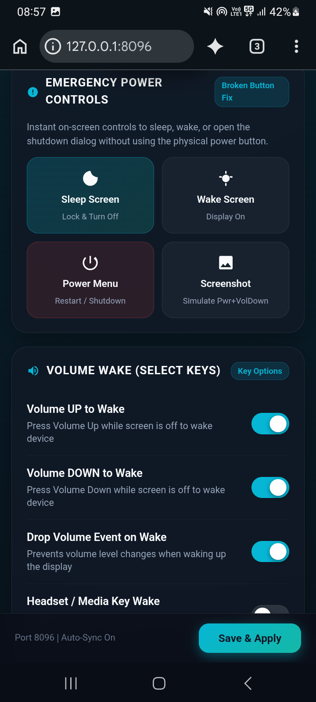
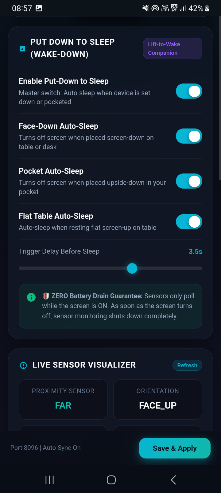

# Galaxy Wake Master (Volume Wake & Put-Down Sleep)
**Author:** hoc  
**Module ID:** `galaxy_wake_master`  
**Version:** `v1.1`  
**Target:** Samsung Galaxy (One UI / Dimensity / MTK / Universal Android 10-14)  
**Control Panel:** `http://127.0.0.1:8096`

---

  
  

---

## 🌟 Overview & Purpose
Designed specifically for smartphones where the physical **Power Button is faulty, worn out, or broken**, **Galaxy Wake Master** provides a complete, battery-friendly, zero-latency replacement system:

1. **Volume Key Wakeup**: Wake your device by pressing **Volume Up**, **Volume Down**, or **Both**.
2. **Drop Volume Event on Wake**: Prevents annoying media/ringer volume changes when waking up the display.
3. **"Put Down to Sleep" (Wake-Down)**: The natural companion to Samsung's built-in *"Lift to Wake"*. Automatically turns off the screen and locks the device when you place it face-down on a surface, put it in your pocket, or lay it flat on a table.
4. **Emergency Virtual Power Panel**: Direct on-screen controls to Sleep, Wake, open the Android Power Off / Restart dialog, take screenshots, or restart System UI.
5. **Integrated Web UI & Magisk Action Button**: Tap the **Action** button in the Magisk app (or open `http://127.0.0.1:8096`) to access the responsive dark glassmorphic control center.

---

## ⚡ How It Works Under The Hood

### 1. Dual-Layer Hardware Wakeup (Zero Sleep Delay)
- **Kernel Sysfs Layer**: Interacts with Samsung's kernel driver at `/sys/class/sec/sec_key/wakeup_keys`, setting `114,115,116,172`, and keeps MediaTek keypad controller (`10010000.kp`) power active (`echo on > /sys/devices/platform/10010000.kp/power/control`). This instructs the kernel to wake the Application Processor (AP) from deep sleep whenever Volume Up or Volume Down is pressed.
- **Systemless Keylayout Overlay**: Injects `WAKE_DROPPED` flags into `/system/usr/keylayout/Generic.kl`, `mtk-kpd.kl`, `gpio-keys.kl`, and `sec_keys.kl`.
- **Event Guardian (`wake_master`)**: A lightweight background daemon blocks on kernel input events (`getevent -l`). When a volume key is pressed while the screen is asleep, it immediately triggers `input keyevent 224` (KEYCODE_WAKEUP) and restores volume levels.

### 2. "Put Down to Sleep" (Native WakeSensor DEX Engine)
- **High-Precision Sensor Daemon (`WakeSensor.dex`)**: Rather than relying on static or gated sysfs nodes (which freeze on Samsung One UI / MediaTek SensorHub), Galaxy Wake Master runs a lightweight native Java bytecode daemon via Android's `app_process`.
- **Direct SensorHub Interfacing**: Connects directly to Android's `SensorManager`, reading raw streams from the physical `LSM6DSL Accelerometer` and `Ear Hover Proximity Sensor (ProToS Lite)`.
- **Face-Down Detection**: Triggers sleep when phone is placed face-down on a flat surface ($Z \le -5.5 \text{ m/s}^2$).
- **Pocket Auto-Sleep**: Detects inverted vertical orientation ($Y \le -6.0 \text{ m/s}^2$) with proximity covered (`NEAR`).
- **Flat-Table Sleep**: Optional setting to sleep when placed flat face-up on a desk ($Z \ge 6.0 \text{ m/s}^2$).
- **Configurable Trigger Delay**: Adjustable delay (default: 2.0 - 3.5s) to eliminate false triggers during active usage.
- **🛡️ ZERO Battery Drain Guarantee**: Sensor listeners are **ONLY active while the screen is ON**. As soon as the screen locks, all sensor listeners are immediately unregistered from the SensorManager. The device enters deep standby sleep with 0% additional battery drain.

---

## 📱 How To Install & Use

1. Download [`galaxy_wake_master_v1.1.zip`](https://github.com/vishalhoc/magisk-galaxy-wake-master/releases) from Releases.
2. Open the **Magisk App** -> go to **Modules** -> tap **Install from storage** -> select `galaxy_wake_master_v1.1.zip`.
3. Reboot your device.
4. After reboot, tap the **Action** button in the Magisk app (or open `http://127.0.0.1:8096`) to customize your wake keys and put-down sleep preferences!
